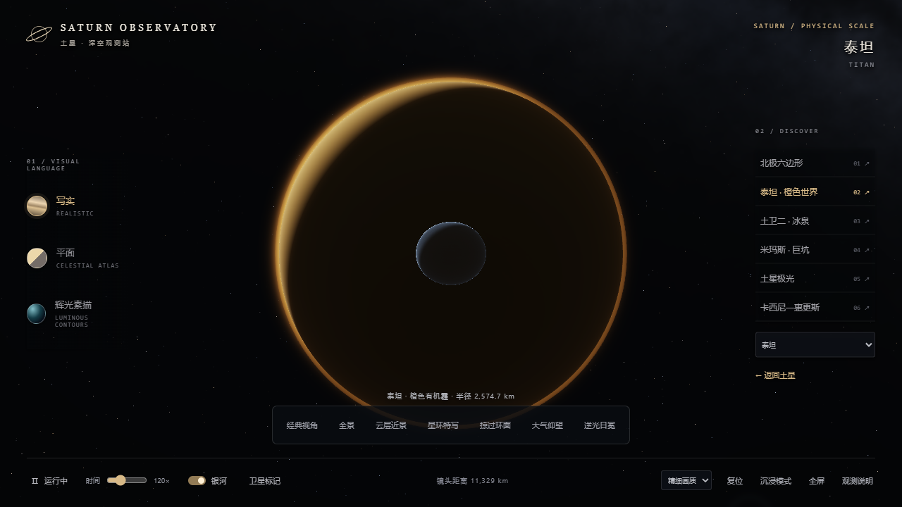
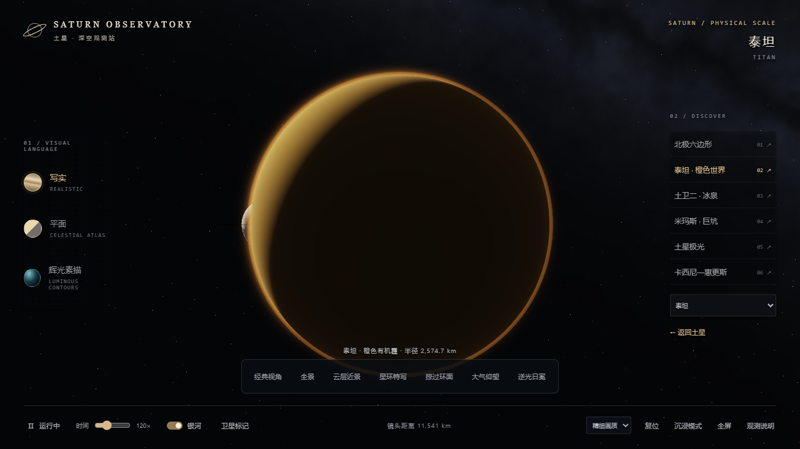

# 3.1.2 大气遮挡修正 — 2026-10-10

状态：本地构建、常规回归、独立浏览器图形检查及完整页面对照通过。项目所有者于 2026-10-10 确认将两次修正合并同步至 GitHub；以下记录为发布前验收过程。

## 问题确认

在相同相机位置复现用户截图：当泰坦位于土星前方时，土星本体正确被泰坦遮挡，但土星的大气散射在最后的全屏处理阶段重新叠加到泰坦圆盘之上，留下蓝色的远景轮廓。原后期散射没有使用场景深度，因此不仅会影响泰坦，也可能影响其他前景天体、冰块或探测器。

图形回归在前方放置不透明表面，确认修复前的土星光晕仍显示，中心像素最大色差为 78 个 8 位灰阶。

## 修正

- 为场景目标增加可读取的深度纹理；根据实际最前方不透明表面的深度截断大气散射，不绘制前景之后的光晕。
- 根据 Three.js 对数深度公式还原视空间距离，再换算成该像素的斜向视线长度，避免画面边缘错误裁掉可见的大气。
- 土星和泰坦大气按各自沿视线的位置从远到近合成；保持前方薄雾的透射和未被遮挡的边缘光。
- 椭球求交改用最近接近点形式，减少远距离轮廓处的大数相减误差。
- 天体本体和星环原有的深度显示保留；半透明大气、稀疏星环仍允许物理上合理的透射，不统一改成不透明。

本版包含 3.1.1 的圆形环粒区域扩大与边界修正。

## 自动检查

完整 `npm test` 的 9 个脚本通过，包括 900 组镜头路线、90,900 个路径样本、8 组中途改选、19 个独立卫星表面、环粒范围及长时间差速分布。

额外运行 `npm run test:gpu` 所对应的独立浏览器测试，共 10 组图形检查：

- 土星、泰坦分别被 4 m 和 10,000 km 处的不透明前景遮挡；抗锯齿分别关闭和开启，共 8 组。遮挡后的像素与无光晕基线一致，最大色差为 0。未遮挡的土星、泰坦光晕仍分别有 78、17 的像素色差。
- 部分遮挡：覆盖侧色差为 0，露出侧色差为 72。
- 斜向视线：前景表面之前的大气仍然可见，像素色差为 73。

上述图形测试使用独立无界面 Chromium / Edge、SwiftShader WebGL，与用户现有浏览器窗口隔离。没有读取私人网页；不等同于已在 iPad 的实际 GPU 上验证。

## 完整页面对照

使用实际页面的模型、纹理、星历和渲染代码，仅在测试副本中固定相机位置。泰坦位于前方时，修正前出现远处土星轮廓；修正后完全遮挡时该轮廓消失，部分遮挡时仍可看到未被遮挡的土星。修正后的完整对照页面无图形编译或运行时错误。






## 本地独立网页

网页为完整单文件，15,273,039 字节，无外部运行资源；原有 7 个历史档案哈希保持一致。

直接载入最终生成的 HTML，通过页面按钮切换至泰坦，并将窗口在 1280×720、1024×768 之间缩放后恢复。标题及诊断版本均为 3.1.2，深度目标随窗口正常更新，检查期间无控制台错误。

```text
SHA-256(index.html)
2591b678f42d0244bb10fed49d95ec589385b09368178428caad5bf7971c3c87
```

此前网站版本为 3.1.0，3.1.1 为星环边界修正的中间版本。本次确认发布的是包含两次修正的 3.1.2，以 `v3.1.2` 标签保存，原有 `v3.0.0`、`v3.1.0` 标签和 7 个原始历史文件保留。
