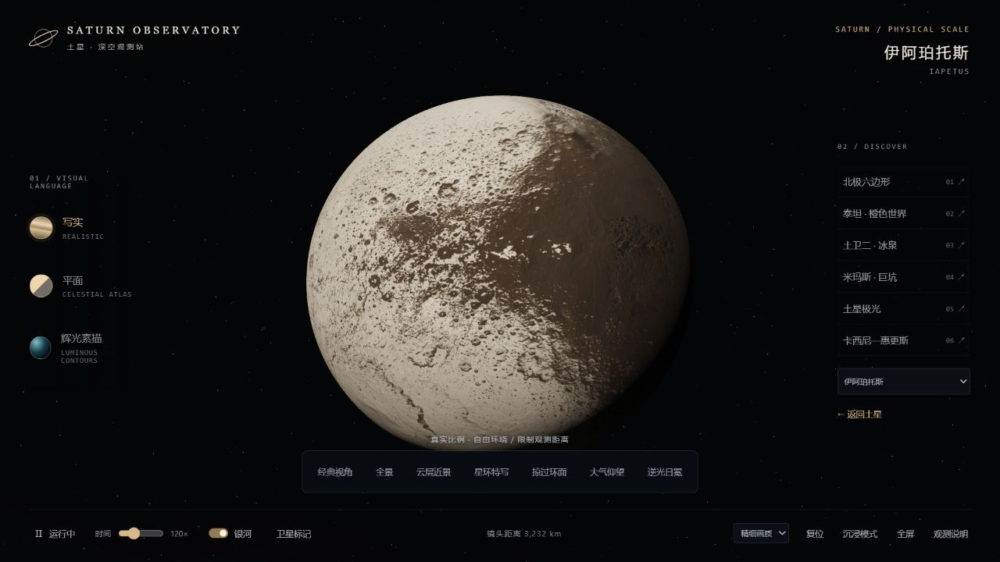
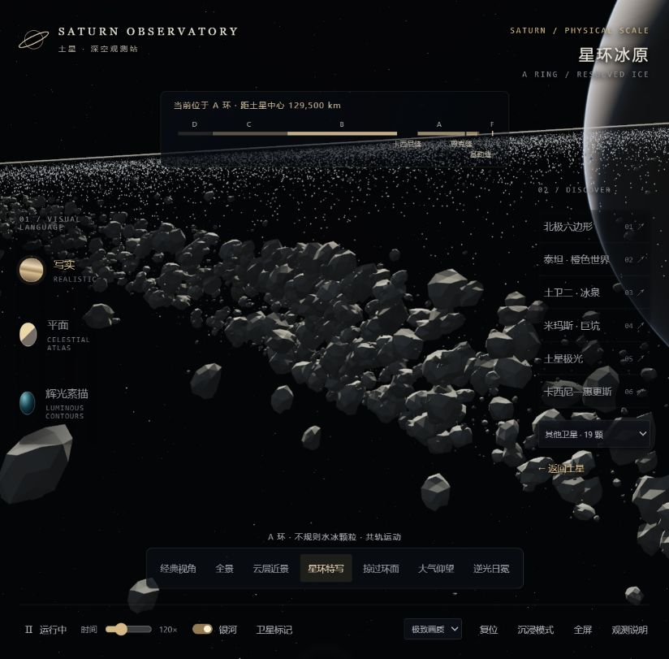
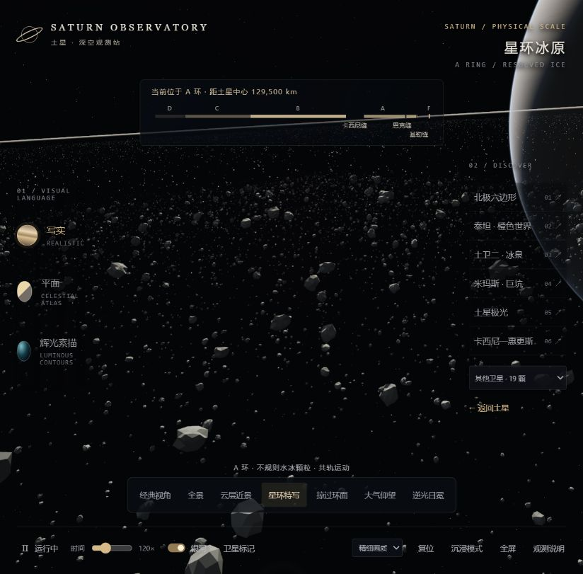

# 3.1 本地更新检测记录

日期：2026-10-04。对象：待项目所有者确认的 3.1.0 本地版本。

## 改动与数据范围

- 8 颗卫星分别加载各自 NASA VTAD 模型与纹理：米玛斯、土卫二、忒堤斯、狄俄涅、瑞亚、泰坦、许珀里翁、伊阿珀托斯。
- 其余 11 颗使用独立形状及表面重建；保留各自三轴尺寸、山脊、坑洼等特征，属于可视化近似，不冒充实测全球模型。
- 三轴尺寸来自 JPL SPICE pck00011.tpc，运行时的天体避让采用模型真实外缘。
- 立体冰粒区域横向约 8 km，外围颗粒层约 64 km；局部环面代理柔化衔接，保留远处整片主环。颗粒在局部区域内差速运动并周期回绕，宽度描述区域横向范围，非恒定圆形直径。
- 星环特写可完整水平、垂直环绕并回望土星；缩放距离限定在 35–82.5 m。
- 修正自定义着色器中的深度代码片段依赖和换行，浏览器实测环面、颗粒及大气可编译。

## 自动检查

| 检查 | 结果 |
| --- | --- |
| 构建 | 成功生成约 15.3 MB 的独立 index.html |
| 观测点转换 | 30 个观测点之间 900 组转换、90,900 个采样点通过；包含全部 19 颗卫星 |
| 镜头连续性 | 起点位置误差 0；最大终点位置误差约 1.94e-9 km；采样点无土星或卫星碰撞 |
| 中途改选 | 8 次通过；最大位置跳变 0；最大角度跳变约 4.22e-8 rad |
| 基础导航 | 5 个情景、10,005 个采样点通过，含直达、避让、圆锥边界与米级接近 |
| 卫星资源互异 | 19 颗表面资源或顶点颜色指纹互不重复，模型尺寸有限且有效 |
| 冰粒覆盖 | 立体区域最大横向半径约 3.997 km，外围颗粒层约 31.995 km |
| 星环环绕 | 水平和垂直可越过一整圈；镜头能朝向土星本体；距离边界保留 |
| 后续时间的环粒范围 | 0、6,000、86,400、10,000,000 秒下，使用实际着色器差速表达式检查外围颗粒保持在横向区域内 |
| 着色器片段 | 深度函数依赖与预处理换行检查通过 |
| 历史档案 | 原有 7 个历史文件的字节数及 SHA-256 全部不变 |
| 离线及隐私 | 素材和运行库内嵌；数据一致；未检出常见凭据、私钥或个人用户路径 |

## 浏览器抽查

独立代码审查未发现严重或重要缺陷；对区域范围措辞的轻微问题已改为横向宽度。

在本机 Chromium 中实际打开本地版本，检查星环特写、环绕回望土星、潘、伊阿珀托斯、许珀里翁及转场。检查时控制台无错误或警告。




## 同日修正：侧视冰块形成矮墙

用户提供截图后复核发现，原半径按 u² 采样使中心面密度出现尖峰，差速运动再将其拉成密集长带。中心 5 m 与中心 50 m 范围的平均面密度之比约 31.25，属于人为分布，不能当作 A 环实际结构。

改用局部面积均匀采样及独立周期细节区域；粗粒样本采用以小冰粒为主的递减分布，1 m 半径以上的冰块比例降低；厚度控制在约 10 m，并将大冰块的中心限制在薄层内部。远处 8 km / 64 km 覆盖及自由环绕保留。

- 新回归检查：中心面密度之比约 0.904，半径超过 1 m 的比例约 1.74%。
- 按实际着色器表达式检查 0、6,000、86,400、10,000,000 秒，未再次形成中心密度尖峰；该数值检查采用 CPU 精度，不代替所有 GPU 的浮点验证。
- 独立审查确认实际变换后的网格顶点在约 ±4.833 m 内，细颗粒保守外缘在约 ±4.576 m 内。
- 浏览器侧视复核：使用与原截图接近的 yaw -2.729、pitch 0.045、zoom 1.65，突出堆积长带消除；另复核回望土星，控制台无错误或警告。
- 完整 900 组镜头转换、卫星独立资源、环粒范围等检查再次通过。

主要资料：[NASA Cassini FAQ](https://science.nasa.gov/mission/cassini/faq/)（典型主环约 10 m 厚）；[B 环特殊高峰](https://science.nasa.gov/resource/the-tallest-peaks-2/)（不将此例外套用于本项目的 A 环位置）。低角度的视线叠加依然可能使真实星环显得很密集。

粒径指数 2.8、样本数及细节区域是可视化取样参数；本次修正去除的是人为尖峰，未宣称完整标定当地实测光学深度、碰撞或自引力尾迹。





## 发布状态与限制

本记录是本地验收，不代表 3.1 已上线。GitHub 与 Pages 的同步需项目所有者确认后执行，并另行记录远端部署及文件一致性结果。

本机 Windows / Node.js 24.15.0 检测通过，不代表所有浏览器、移动设备和 GPU 的兼容性。粒子与小卫星重建属于科普近似；原历史快照保持原样，本次结果只适用于 3.1。

最终本地网页：15,271,645 字节。

```text
SHA-256(index.html)
036ef562572efc9abbc635dc9a05239afe60e2377a01476e4f6579560f95f138
```
